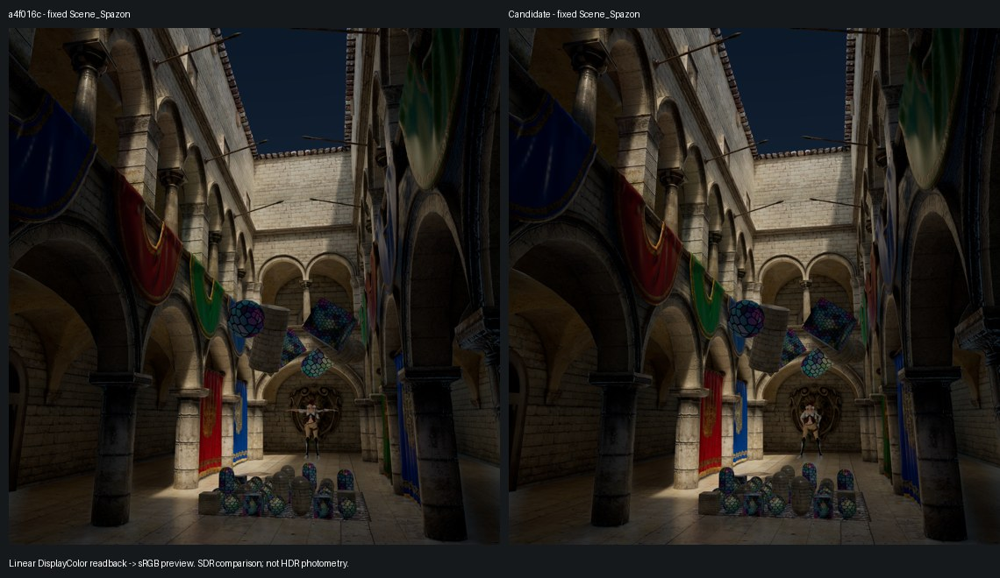

# Main-thread, GC, surface storage, SSGI binning and native HDR

Implementation baseline: `main / a4f016c6d1ab391a7fb1524df90d512760aadb5b`.
Validation: Unity 6000.6.0f1, Apple M3 Max, macOS Metal, one task-owned full
InfinityExample mirror. No source scene/material/profile was saved, no Player
was built, and no branch, commit or push was created.

[Machine-readable receipts and physical texture ledger](Evidence.json) contain
test run IDs, bounded CPU measurements, upload counters, physical descriptors,
capture statistics/hashes, native display evidence and restoration status.

## Changes

- Dynamic Mesh world matrices and bounds use persistent TransformAccessArray /
  Native storage and a Burst batch. Static poses, Mesh geometry, routing and
  instance configuration use explicit typed mutation/notification APIs. Existing
  serialized names and references remain intact. Material arrays are read-only
  to callers. Inspector/Undo changes notify; loading never saves/migrates assets.
- Probe requests follow pose/configuration/probe revisions. One reusable,
  generation-checked MeshScene transaction publishes a movement batch. Instance
  removal visits its owned draws instead of the entire draw table. Graph arrays,
  consumer lists, staging, visibility frusta and version patches reuse bounded
  storage over their original ownership intervals.
- Repeated Unity lightmap-array getters, encoder boxing, captured delegates,
  marker strings and inactive RTAO geometry rebuilds were removed from the normal
  hot path. Runtime lightmap replacement requires
  `MeshComponent.NotifyBakedLightingChanged()`.
- Asset backend policy defaults to Auto. Debugger override supersedes it and
  clearing the override restores the Asset policy. Explicit validation policy is
  camera-bounded. CPU records no Mesh culling/compaction compute nodes.
- SSR/SSGI metadata is RG32UInt: exact float32 raw-depth bits plus oct12x12 normal,
  age7 and validity. Integer Load is the sole metadata sampling operation. Metal
  capture decodes to float only when diagnostics request readback.
- SSGI uses 8x8 LDS compaction, one global reservation per nonempty tile and
  64-wide indirect ray groups. Binning initializes every logical pixel's zero
  contribution. Skip storage/clear kernels are gone. Trace and Spatial share work
  storage; explicit Trace capture snapshots before overwrite. RayHit is diagnostic
  only. SSR Resolve/Temporal/Spatial/history remain full resolution; SSGI has no
  Resolve. Non-Async devices record these producers immediately before composition.
- HDR uses current native state and validates transfer, gamut and format.
  `Rec2020_Linear=3` was appended without renumbering existing encodings. CoreRP
  converts primaries/reference white; output owns and restores automatic HDR
  tonemapping, including replacement of the owning pipeline.

## Main-thread and allocation results

Same fixed camera, 1666x1756, Quality 0 and full Scene_Spazon; original local poses
and animation were frozen. Each case used 32 accepted warmup submissions and 120
samples. Times below are CPU scope measurements, not isolated GPU timings.

| 10k instances | Baseline Proxy p50 / p95 ms | Candidate Proxy p50 / p95 ms | Candidate Render p50 / p95 ms |
|---|---:|---:|---:|
| CPU, stationary | 63.983 / 69.493 | 0.103 / 0.129 | 2.553 / 2.864 |
| CPU, 1% moving | 65.168 / 75.542 | 0.382 / 0.416 | 5.201 / 5.689 |
| CPU, 100% moving | 194.363 / 215.538 | 21.568 / 22.106 | 27.605 / 28.328 |
| GPU, stationary | 63.254 / 69.825 | 0.105 / 0.129 | 2.284 / 2.466 |
| GPU, 1% moving | 65.649 / 69.755 | 0.389 / 0.428 | 5.627 / 6.023 |
| GPU, 100% moving | 189.726 / 212.476 | 22.028 / 22.828 | 27.028 / 28.087 |

The complete 1k matrix also passed. At 50k, explicit Static Proxy p50/p95 was
0.006/0.010 ms; all-dynamic, stationary was approximately 0.399 ms p50 and fully
moving was 104.757/105.713 ms. Large fully moving scenes still have a substantial
CPU cost; this result does not claim otherwise.

GC measurement was calibrated against a known allocation. This Unity Mono's
`GC.GetAllocatedBytesForCurrentThread` returned zero even for a known 1 MiB
allocation, invalidating early byte-counter results. Acceptance uses the native
`GC.Alloc` ProfilerRecorder's allocation **count**. Its Value is marker time, not
byte size. Final stationary and moving 1k/10k/50k sampling windows recorded zero
Proxy allocations and four full-Render allocations per frame, all four inside
Unity's native `ScriptableRenderContext.Submit`. Raw profiler call stacks located
two GUILayoutUtility.Begin and two GUILayoutGroup allocations (368 bytes total)
there. Thus the measured controllable normal library path is zero GC; the entire
Unity Editor is not. Active URT/RTAO, initialization, growth, Debugger, capture and
diagnostic observers are outside this zero-GC acceptance.

One earlier 10k CPU movement window contained five additional allocations in one
sample. That sample was not accepted as zero. The final repeated 120-frame window
had exactly four native-Submit allocations throughout, zero Proxy allocations and
stable physical allocation counts. No unproved cause is assigned to the earlier
sample.

Separate observers measured 119 intervals of 10k updates: stationary scenes made
zero transactions and uploaded zero transform/attribute bytes; moving scenes
made exactly one movement transaction per interval. Transform patch uploads were
10,240–12,160 bytes/interval at 1% movement and 800,640 at full movement. Existing
safe version replacement can still upload full attribute tables: measured
attribute traffic was 1,649,824–2,201,760 bytes/interval. No bandwidth reduction is
claimed for those tables. CPU Mesh culling/compaction counts were 0/0; GPU counts
were 6/8 in this full scene.

## Physical texture memory

Same source scene/assets/settings and logical size; padded capacity 1728x1792.
All numbers are format estimates, not driver residency. Physical IDs and complete
compatibility descriptors are retained, including logical aliases and current
recording/pending/CPU-write state where that revision exposes it.

| Storage | `2485580` | Candidate | Delta |
|---|---:|---:|---:|
| Stable pool / observed pool peak | 498.405 MiB | 497.421 MiB | -0.985 MiB |
| Image history, committed + pending | 259.875 MiB | 196.875 MiB | -63.000 MiB |
| All created RenderTextures, including other persistent / Unity Editor | 917.090 MiB | 853.106 MiB | -63.985 MiB |

The candidate has 30 pooled physical textures versus 26 in `2485580`; count alone
does not measure memory. The stable-pool goal is met without moving allocation
ownership out of the pool. Against this round's `a4f016c` baseline, pool storage
fell from 532.858 to 497.421 MiB, a 35.4375 MiB reduction:

| Change | Pool reduction |
|---|---:|
| Full-resolution SSR metadata, 16 to 8 bytes/texel | 23.625 MiB |
| Half-resolution SSGI metadata, 16 to 8 bytes/texel | 5.90625 MiB |
| SSGI Trace/Spatial shared RGBA16F work storage | 5.90625 MiB |

Removing normal SSGI RayHit also removes UAV work, but adds no further retained
pool saving in this scene because that lifetime already aliases SSR RayHit.
Diagnostic captures allocate additional staging/decoded metadata and are excluded
from the normal ledger. `2485580` used different effect storage layouts; its
ledger is a physical-memory comparison, not a claim of bit-identical algorithms.

## Compilation, numeric tests and full scene

- Static gate: zero errors/warnings; 12 static negative tests pass.
- Final selected Unity batches: 458 passed executions, zero failed, one hardware
  Async skip; 443 distinct passed test names and one distinct skipped name.
  These counts include repeated coverage between filters, not a whole-repo total.
- Mesh 96, routing 19, Output 84, SSGI 39, SSR 8, metadata 1, ResourcePool 12,
  GpuScene 6, RG 45 + one skip, submission 7, feature registry 5, baked lighting 2,
  shadows 85, SSS 11, probes 24, quality lifecycle 11, seam 2 and one final native
  linear output GPU case. The latest Mesh batch includes custom camera culling
  matrices and calibrated allocation-free transaction loops.
- Production metadata tests preserve depth bits and ages 0–64 and bound normal
  error to 0.1 degrees. Production SSGI tests cover empty/sparse/dense/odd bins,
  quad phases, compact-list uniqueness, zero work, temporal response, reconstruction
  and alias-safe capture.
- Generated Lit/Unlit/Decal Graphs imported with 11/1/1 passes and actually drew.
  After full-scene draws, 25 loaded ComputeShaders and 15 Shaders/Graphs had empty
  diagnostics. After final review/import, 27 ComputeShaders and 15 Shaders had
  empty diagnostics, including the metadata capture helper. No cache was erased.
- Final normal MainCamera state accepted frame 4596 at 1666x1756, Quality 0:
  Depth, GBuffer, Motion, HiZ, SSR, SSGI, Deferred, TAA, color/history pyramids,
  post and display were requested/supported/produced. Optional features not
  requested in the source scene are identified as such in Evidence.json.
- Main SDR candidate captured 11 buffers, all finite, with actual presentation.
  Same-camera `a4f016c` comparison retained actual draws and similar appearance.
  Linear DisplayColor RGB absolute error: mean 0.000488, p99 0.005859; stochastic
  frame/jitter sequences differ, so this is not a bit-identity test.
- A runtime-only supplement preserved that chain and produced SSS, fog/cloud,
  Cookie/EVSM and actual DBuffer Graph draws. SSS diffuse and moment/DBuffer/SSR/
  SSGI readbacks were finite and nonzero. Main-camera cloud RGB was zero; a separate
  owned cloud-layer camera proved nonempty production: 85 RGB pixels, max 79.25,
  zero nonfinite values. Fog history contained 2,942,720 nonzero RGB voxels and
  zero nonfinite values. This is bounded execution/visual acceptance, not an
  arbitrary-cloud quality reference sweep.

The preview converts linear DisplayColor to sRGB for inspection. It is not a
measurement of the HDR display.

## Native XDR HDR

This run activated native HDR on the internal XDR display: available=true,
active=true, no mode transition pending, `R16G16B16A16_SFloat`, linear Rec.2020,
paper white 160 nits. The normal native Metal render-pass color attachment was
`RGBA16Float` (pixelFormat 115), 1666x1756. Output policy was
`ShaderRec2020Linear`; automatic HDR tonemapping was false under pipeline ownership.
This is actual native presentation evidence, not an offscreen float-RT substitute.

The Main Agent inspected the running XDR scene with gray/highlight steps,
saturated/alpha UI and the generated surfaces. Readback of the seven linear UI
steps was `[0, 0.010002, 0.180054, 1, 2, 4, 8]`. A +1 exposure control changed the
world ROI mean from 0.042972 to 0.094080 while UI steps stayed unchanged; tonemapping
is nonlinear, so no exact 2x assertion is made. GPU tests cover primaries,
paper-white scaling and UI blending. SDR/HDR mode switching restored native SDR
and automatic tonemapping=true. Absolute display luminance/colorimeter accuracy,
other native HDR encodings, external displays and Player are not accepted here.

## Boundaries, review and cleanup

The Main Agent reviewed ownership, failure paths and the complete diff. Resource
pool changes reuse only empty managed buckets; recording, pending submission,
GPU completion, CPU-write and cancellation eligibility are unchanged. Metal
lifecycle tests pass, but **whole pool lifecycle remains PARTIAL**: this host
reports supportsAsyncCompute=false. Actual hardware cross-queue execution and
native driver Submit-failure recovery remain unverified. D3D12/Vulkan, unexecuted
RT backends and the independent Player RTAO loading gap remain unverified.
No credible isolated GPU timing was available, so no GPU acceleration is claimed.

Historical baseline replay briefly used a mismatched diagnostic helper include;
the replay script was corrected to keep baseline code exact. A cloud diagnostic
script initially queried the wrong state field; its corrected readback passed.
These task-harness failures are not hidden as renderer successes. Unity TLS /
licensing service messages were observed independently of successful scene
rendering; they did not block these tests. Current package ShaderUtil diagnostics
are empty.

Source integrity checked 514 protected paths: 513 were byte-identical; the sole
delta is this task's intentional `Compute_CaptureTexture.compute` implementation.
No protected scene/material/LUT/profile changed. Four bounded capture groups
contained 558,381,856 raw bytes, below the 1 GiB limit. Cleanup completed: owned
Editor PID 27663 exited, the exact APFS image was detached, and the mirror, cache
image/mount and task directory were verified absent. Source Library still points
to its original cache. Scene was reloaded clean, Play/pause were off, Asset
SDR/PQ/Auto and original HDR settings were restored, Game View returned to 16:9,
and all task producers/readbacks/tests were idle. Approximately 6.67 GiB of
task-owned allocated files were removed. Only this report, structured receipts
and the SDR preview remain (about 650 KiB including their meta files).

Delivery cleanup on 2026-10-26 also removed the obsolete generated
`Library.exfat-original` copy (45,069 files, 2,757,573,176 logical bytes), the
remaining empty verification/profiler directories, and 2,063 magic-verified
AppleDouble sidecars. The project's `intermediate/` is absent. Current Library,
image baselines and historical reports' selected evidence were preserved.
Git object and LFS integrity checks passed after sidecar removal.
