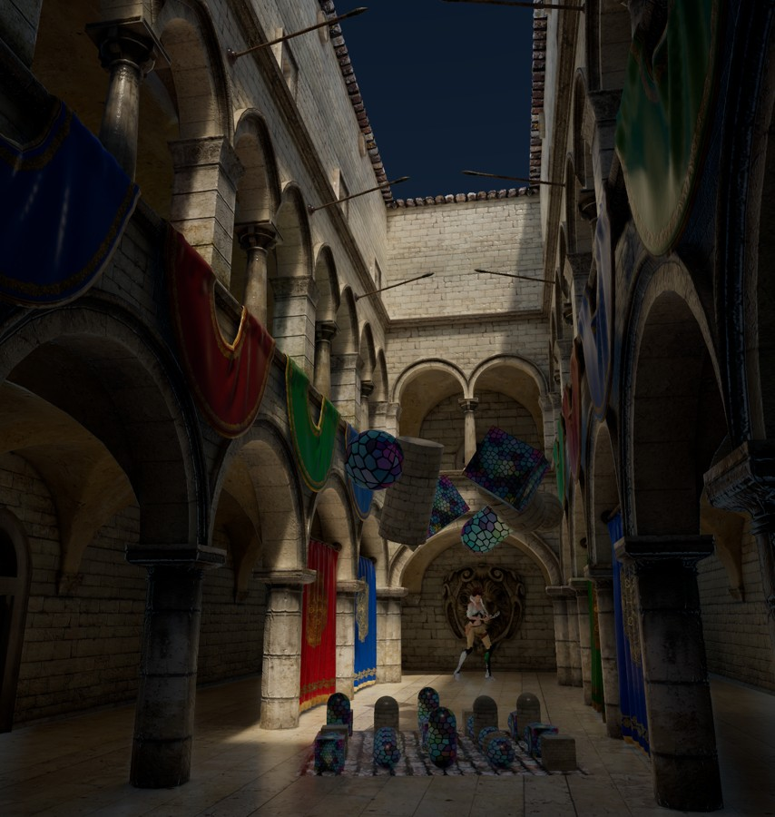
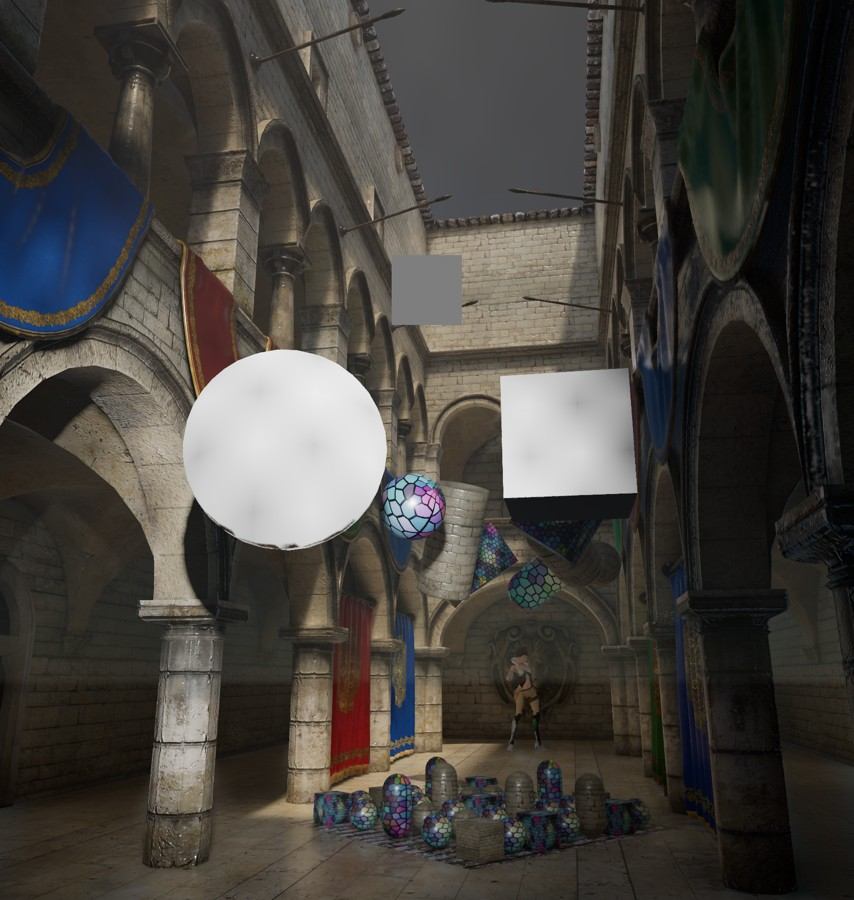

# Visibility, shared history and screen-space chain — 2026-10-25

Candidate based on `main / 2485580d1a4708b1711c6780b4f73b464bf11d61`.
No branch, commit, push, Player build or shutdown was performed.

Implementation and local Metal integration are complete. The resource-pool whole
lifecycle gate remains **PARTIAL**, and hardware overlap/performance is unverified.
This receipt does not turn bounded scene checks into arbitrary-scene quality proof.

## Delivered behavior

- Scene-owned immutable Mesh transform/generation versions replace per-camera
  pose arrays and full previous-transform uploads. Dirty pages upload once per
  version; views accept their own version only after a successful submission.
- Closest/Furthest half-base HiZ and conservative first/recovery GPU culling feed
  recovered depth and final GBuffer/Forward/Motion visibility. CPU Direct and
  native Unity motion remain independent.
- Physical resource identity, RAW/WAR/WAW and pooled reuse cover recording,
  unsubmitted/submitted use and cancellation/uncertain outcomes. Immediate CPU
  writes require actual completion or independent writable storage.
- SSR: optional half Trace, full Resolve/Temporal/Spatial/history. SSGI: **no
  Resolve**, direct accepted previous-color Trace, working-grid Temporal and
  recurrent world-space Spatial, full geometric reconstruction. Rotating quad
  positions and shortened odd-edge intervals are represented explicitly.
- Accepted unsharpened TAA/SR color and shared extra mips supply both effects.
  Current object metadata supplies expected previous surface depth. Sharpened
  SR color no longer enters history.
- GTAO accumulates visibility/normal/depth/age before artistic shaping. Burley
  SSS filters half-resolution diffuse only, then replaces that component in the
  full opaque result. Profile indices remain per material; Volume enable does
  not select profile zero for every surface.
- Async candidates are placed before an independent shadow raster window;
  effect history copies follow it. Early recovery and immediately dependent late
  effects remain on Graphics. Device capability chooses the effective queue.

The SSGI ResolveSamples/ResolveRadius fields and six default-profile YAML lines
are deliberately removed. There are no compatibility aliases or automatic
asset migrations. User scenes/materials/LUTs were not saved for validation.

## Verification

The selected completed batch receipts and run GUIDs are in [evidence.json](evidence.json).
They total 320 passing observations and one unsupported-hardware skip; batches
overlap, so this is **not** a unique whole-repository test count.

| Area | Selected result |
|---|---|
| Pool intervals / actual delayed Metal submission / submission results | 12 / 4 / 6 pass |
| RenderGraph | 45 pass, 1 hardware-async skip |
| Mesh consumers | 92 pass |
| Transform-version / occlusion / real-camera recovery | 1 / 4 / 1 pass |
| Dual HiZ / initialization | 9 / 14 pass |
| Shared temporal color / SR unsharpened history | 13 / 4 pass |
| GTAO visibility/artistic transform | 18 pass |
| Stochastic SSR/SSGI, including four quad phases | 16 pass |
| SSGI temporal/world-space response | 21 pass |
| SSS diffuse, profile, boundary, impulse and residual preservation | 9 pass |
| Camera history / quality / Deferred GPU / registry | 11 / 22 / 13 / 5 pass |

Static gate: 0 errors / 0 warnings; 12 static negative controls passed.
Unity incremental compilation: 0 errors / 0 warnings. Cold compilation separately
retains the pre-existing `LightProbeProxyVolume` CS0618 validation-fixture warning.
Generated Lit/Unlit/Decal Graphs imported; their 13 passes plus Lit Forward's SSS
variant compiled on Metal. Final public ShaderUtil messages were empty for 26
loaded package ComputeShaders and 28 package/generated Shaders after production
execution. The final restarted candidate log had no shader warning/error,
invalid kernel, missing binding or assertion.

Initial failures were retained while debugging, not ignored: SSGI world-filter
RMS was approximately .058 against the unchanged .03 budget; projected support
was corrected and the final response suite passed. Early fixtures needed correct
scene ownership/frame progression and Metal control-flow initialization. A
baseline hot-swap import produced mixed assembly/kernel diagnostics; the final
candidate was restarted and accepted against a separate fresh log.

## Complete scene evidence

One task-owned mirror, Unity 6000.6.0f1, Apple M3 Max / Metal, Scene_Spazon,
Quality 0, MainCamera 1666x1756. No original Editor was controlled or closed.

The final original-settings capture at game frame 9533 used 32 warmup accepted
submissions plus one captured frame. All 12 readbacks were finite and outstanding
requests reached zero. SSR Resolve/Temporal/meta/output were 1666x1756; SSGI
Trace/Temporal/meta/hit distance were 833x878 and output was 1666x1756. The source
was accepted UnsharpenedTAA. Camera pose and full descriptors are summarized in
the evidence. Animated objects vary between normal captures; these images are
normal-output inspection, not a pixel-identical animated regression baseline.

A runtime-only supplement retained the original SSR/SSGI/TAA chain and activated
SSS, GTAO, cloud/fog, Cookie, EVSM/contact and generated Lit/Unlit/Decal Graph draws.
All requested supported supplement features were produced; all eight captured
outputs were finite. ScatterDiffuse was full size, Burley output 833x878 and final
color full size. DBuffer and local moments were nonzero. Cloud output was neutral
in this camera; visible-cloud quality remains unverified. Main Agent inspected
the normal presented output, including SSS sphere and Graph objects.

An earlier same-world supplemental SR camera used display 128x128/internal64x64
alongside the original TAA camera. Both accepted sources and readback statistics
were finite at frames 5382/6201; this is SR integration evidence, not original-size
SR image acceptance. The unchanged-color late main-camera means stayed near
.0463 in that bounded run; this is not a general feedback-stability proof.

## Matched measurements

Baseline and candidate each ran static, dynamic and two-camera cases, 32 warmup
plus 120 accepted main-camera submissions per case. Camera/effects were fixed;
Time.timeScale was zero during sampling; the owned Mesh actor followed the same
accepted-frame motion. Producers drained before teardown. No GPU timing samples
were available; CPU/wall-clock numbers are not substituted for GPU timing.

- Within all six windows, texture and buffer allocation counts stayed constant.
- Static candidate scene version count/production/upload stayed at 1 / 1 / 640
  cumulative bytes: no transform upload during the sample window.
- Dynamic single and two-camera candidates each produced 119 versions and 85,680
  patch bytes over 119 sample intervals. Both views shared each scene production.
  CPU per-view pose arrays and previous-pose uploads are gone.
- The scene has only nine live transform slots. A dirty-page patch includes index
  and generation; 720 patch bytes per changed version can exceed the old 576-byte
  single-view previous matrix upload. GPU copy work also exists for changed
  versions. No universal bandwidth or speedup claim is made.
- Estimated pooled texture allocation increased from 522,615,920 to 558,742,496
  bytes for the main view (approximately +34.45 MiB). Dual HiZ, 32-bit geometric
  metadata and shared history mip work have a cost. History/native/driver memory
  is not fully represented by pool counters; these are format estimates.

## Remaining gates

- **Resource pool: PARTIAL.** Actual cross-queue execution and real native Submit
  failure recovery require a supporting API. Unknown native outcomes remain
  quarantined; later frames cannot acknowledge them. Metal delayed/cross-camera/
  cancellation/incomplete-disposal tests do not close those gates.
- This Metal device reports supportsAsyncCompute=false. Queue topology tests and
  candidate eligibility do not prove hardware overlap or acceleration.
- D3D12, Vulkan, real HDR display and unrun RT backends remain unverified.
  The separate existing Player RTAO loading gap is unchanged; no Player was built.
- Arbitrary-scene visual quality, a high-sample quality sweep and original-size SR
  image acceptance are not inferred from the bounded scene and numeric fixtures.

## Restoration and cleanup

Final source integrity checked 642 protected files: only the explicitly removed
SSGI default-profile fields differed. No source scene/material/LUT was overwritten
or globally saved. The owned validation mirror temporarily held baseline code;
the source checkout never switched revision. The same mirror was restored to the
candidate for final tests and frames.

Cleanup is **Verified** in evidence.json. Captures had zero outstanding requests;
owned callbacks and objects were absent, with stopped/unpaused state, original
camera size/quality, clean scene/asset and background=false. Only the task-owned
Editor was closed. Its exact APFS image was detached before removing the mirror,
cache, captures and task directory; both run and task parent are absent. The
external Test Framework XML was deleted only after a byte-identical match to this
task's final result. The original project's existing Library symlink/cache stayed
untouched. Approximately 403 KB of compact evidence and two previews remain here.
